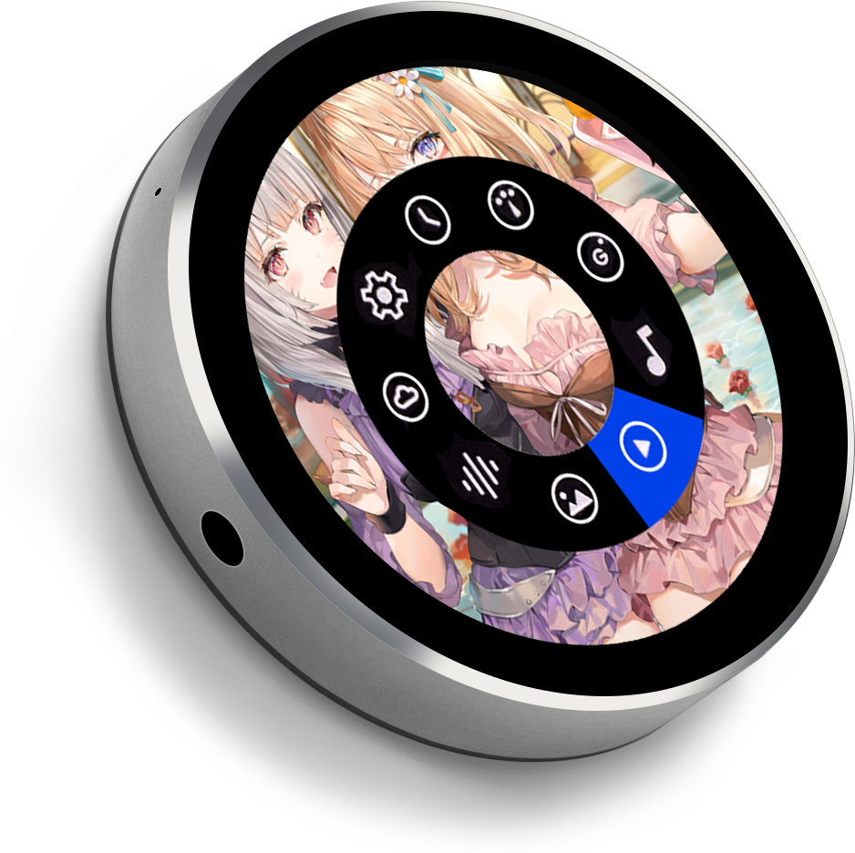

# VIEWE Smart Ring Plus — ESP-IDF Firmware

<div align="center">
  
</div>

ESP-IDF project for the **VIEWE "Smart Ring Plus"** — a round, 1.8-inch
(360×360) capacitive-touch terminal built around the **ESP32-S3-N16R8**
(8 MB octal PSRAM / 16 MB flash). The firmware boots the board through the
official `viewesmart/smartring_plus` Board Support Package and renders with
**LVGL 9** via `esp_lvgl_adapter`.

It is structured as a **generic skeleton plus interchangeable applications**:
`components/ringkit/` wraps the whole BSP, and each app under `examples/<name>/`
is selected at build time with the `RING_APP` cache variable.

## Hardware

| | |
|---|---|
| SoC | ESP32-S3-N16R8 (240 MHz dual-core, 8 MB octal PSRAM, 16 MB flash) |
| Display | 1.8" round IPS, 360×360, ST77916 QSPI + CST816 capacitive touch |
| Audio | ES8311 codec + I2S (48 kHz / 16-bit / stereo), dual mic, speaker (NS4150B PA) |
| IMU | QMI8658A 6-axis (accel / gyro / temperature) |
| Storage | MicroSD (SDMMC 4-bit, FAT, `/sdcard`) |
| Battery | 3.7 V / 600 mAh LiPo; AXP2101 PMIC (V2) or GPIO1 ADC (V1), auto-probed |
| Power | GPIO47 soft power-off |
| Console | USB-Serial/JTAG (native USB, `/dev/ttyACM0`) @ 115200 baud |

## Quick start

Requires ESP-IDF **v6.1** (`IDF_PATH` already exported) with the `esp32s3` target.
The device console is the USB-Serial/JTAG port — **`/dev/ttyACM0`**.

```bash
idf.py set-target esp32s3      # first time / after deleting a build dir
idf.py build                   # default app (11_glyph_grid_reveal)
idf.py -p /dev/ttyACM0 flash monitor
```

Any other app — always its **own build dir**, and pass the same `-B` to build,
flash and monitor (otherwise `flash` picks up a different image):

```bash
idf.py -DRING_APP=04_voice_loopback -B build/04_voice_loopback build
idf.py -DRING_APP=04_voice_loopback -B build/04_voice_loopback -p /dev/ttyACM0 flash monitor
```

An invalid `RING_APP` fails fast at configure time and lists the valid choices.

The apps that need credentials (`05`–`07` and `10`: Wi-Fi SSID/password,
Qianwen API key) take them from `./secrets.local` (git-ignored), never from the
command line, so they stay out of shell history and the build log.
`tools/dev.sh` wraps that:

```bash
tools/dev.sh build 06_qianwenai_push_to_talk    # build one app
tools/dev.sh flash 06_qianwenai_push_to_talk    # build + flash to /dev/ttyACM0
tools/dev.sh monitor 06_qianwenai_push_to_talk  # follow that app's build dir
```

> **Console back-pressure looks like a hang.** With USB-Serial/JTAG as the
> console, `ESP_LOG*` writes block whenever the host stops reading
> `/dev/ttyACM0`. Always drain the port continuously (e.g. `idf.py monitor`) —
> a capture script that sleeps before reading will stall the firmware mid-boot.

## Applications

| App | Description |
|-----|-------------|
| `01_gbuddy_face` | The buddy face: 4 expressions from `medias/gbuddy-00N.png` as alpha sprites, with blink, IMU gaze, twist look and sleep. |
| `02_imu_dashboard` | Live IMU dashboard: bubble level (tilt) + accel + gyro + temperature + level calibration. |
| `03_gesture_probe` | Reports every single-finger gesture (tap / hold / swipe / press / release) the moment it happens. |
| `04_voice_loopback` | Mic + speaker loop-back: hold to record, release to play the capture back. |
| `05_wifi_https_demo` | Wi-Fi station: connects to the NVS-stored SSID, shows state/SSID/IP, then GETs `https://baidu.com` to prove outbound TLS. |
| `06_qianwenai_push_to_talk` | Push-to-talk voice assistant: hold to talk, the ring runs STT → LLM → TTS over HTTPS and speaks the reply. |
| `07_qianwen_realtime_harness` | Hands-free WebRTC voice loop: Wi-Fi → SNTP → HTTPS probe → session, then live mic → Opus → Qianwen → Opus → speaker with server-VAD turn-taking. |
| `08_ble_peripheral` | Bluetooth LE peripheral: advertises as `SmartRing` and exposes a GATT server. |
| `09_hello_smoke_test` | Bring-up smoke test: white screen + one large label. |
| `10_qianwen_ws_voice_chat` | WebSocket voice chat with `qwen-audio-3.1-realtime-flash`: PCM 16 kHz in / 24 kHz out over `esp_websocket_client`, push-to-talk / `server_vad` / `smart_turn_v2` turn-taking, orb + chat/settings screens. The only realtime transport that works where UDP is blocked. See `examples/10_qianwen_ws_voice_chat/README.md`. |
| `11_glyph_grid_reveal` | **Default.** 13×13 glyph grid, layered center-out reveal driven by the ring's gyro (turn to reveal more/less), green/yellow accents. Tap resets to the idle core. |
| `12_ringkit_selftest` | Bring-up diagnostic: probes display/touch/audio/IMU/SD/battery, then init/stop for Wi-Fi, BLE and the voice modules. |
| `13_button_probe` | BOOT-button (GPIO0) probe: shows `press` / `long press` / `click` / `dbl click` the moment each fires, with a live held-time line and per-event counters. See `examples/13_button_probe/README.md`. |

> `07` needs a network that allows **outbound UDP** for DTLS; on a
> UDP-filtered LAN it connects as far as ICE and then times out. See
> `notes/networking-https-webrtc.md` §8. `06`/`10` are TCP/443-only.

## Architecture

```
main/                     app-agnostic entry: ring_board_init() -> ring_example_start()
components/ringkit/       generic skeleton wrapping the whole BSP
components/<vendored>/    local overrides (esp_codec_dev, smartring_plus) — see AGENTS.md
examples/<app>/           CMake fragments compiled into main
scripts/                  host-side helpers (test_qianwen_realtime.py)
tools/                    dev.sh (build/flash wrapper), lvgl_img_pack.py (sprite assets)
notes/                    research + design notes
```

The repo used to be a single app: `main/main.c` did BSP bring-up *and* the UI,
and nothing was reusable — the bring-up order, LVGL lock discipline, theme
constants and the deterministic RNG were all trapped in one launcher. The
split makes `components/ringkit/` the only place that talks to the BSP, so
every app gets the correct bring-up order, a leak-proof LVGL lock, the shared
look and the deterministic RNG for free. **Adding an app is one directory**
and never touches `main/` or `components/`.

Applications **never** include `bsp/smartring_plus.h` and never call `bsp_*`
directly — everything goes through `ringkit/ringkit.h`. Board bring-up order
lives in `ring_board_init()`: **display first** (it creates the shared I2C bus
and starts the LVGL task), then battery → power → audio (mandatory), then
SD → IMU (fail soft). All LVGL work happens under `RING_UI_LOCKED(-1) { ... }`.

### How exactly one app is selected

The project `CMakeLists.txt` is evaluated before `sdkconfig` exists, so a
**CMake cache variable** (`RING_APP`, default `11_glyph_grid_reveal`) is the
only viable selector there — a Kconfig `choice` would compile the selection
into `sdkconfig`, which is harder to script and invites "I flashed the wrong
app". `main/CMakeLists.txt` `include()`s `examples/${RING_APP}/CMakeLists.txt`
— a three-line fragment that sets `RING_EXAMPLE_SRCS` / `_INCLUDE_DIRS` /
`_REQUIRES` — and folds those into its own `idf_component_register()`. An
invalid `RING_APP` fails fast at configure time with the list of valid choices.

### The two ESP-IDF traps that shaped the layout

**Examples are CMake fragments, not components.** The obvious design — every
example a component registered via `EXTRA_COMPONENT_DIRS`, all named the same
so `main` could always `REQUIRES ring_example` — **does not work in
ESP-IDF**:

1. Component registration order puts `main` **before** `EXTRA_COMPONENT_DIRS`
   components.
2. `__component_set_dependencies()` only links a requirement if the required
   component's target is *already* registered — otherwise it is silently
   dropped.

So a `REQUIRES` entry pointing at an example vanishes with no diagnostic, and
the build fails later on `#include "ring_example.h"` with no hint about the
cause. `include()`-ing the selected example's `CMakeLists.txt` from `main`
avoids the whole class of ordering bugs. Cost: examples are not standalone
components, so they cannot be unit-tested or depended on independently.

**`main/CMakeLists.txt` is evaluated twice.** ESP-IDF also runs a
requirements-gathering pass in a separate CMake process where cache variables
are not set (`RING_APP` is empty) and `CMAKE_SOURCE_DIR` is the **build
directory**, not the project. Hence the root is resolved via
`${CMAKE_CURRENT_LIST_DIR}/..` and `11_glyph_grid_reveal` is used when
`RING_APP` is empty. Getting this wrong produces `include could not find
requested file: …/build/…/examples//CMakeLists.txt`.

### Lock discipline

`RING_UI_LOCKED(-1) { ... }` is a double `for` loop with a `cleanup` handler,
so it unlocks on every exit path (`return`, `break`, `goto`) — a hand-written
`ring_ui_lock()`/`ring_ui_unlock()` pair leaks the lock on early return. The
order of its parts is load-bearing: the unlock must happen in the loop
**increment**; setting `.ok = false` there instead looks equivalent but is not
— the increment runs before the `cleanup` handler, so the handler sees
`.ok == false`, skips the unlock, and leaks the mutex on the normal path. That
bug shipped in the phase-1 refactor and cost a long debugging session. Because
`esp_lv_adapter_lock()` is recursive, the leaking task keeps working, and the
symptom is the **LVGL worker task** starving forever in
`esp_lv_adapter_lock(-1)` — the screen keeps whatever was flushed during
bring-up and nothing the app draws afterwards ever appears, with no panic,
assert or error log.

### What must not change

- The vendored overrides `components/espressif__esp_codec_dev/` and
  `components/viewesmart__smartring_plus/` (project `components/` outrank
  `managed_components/`, so they win even if the component manager
  re-downloads the originals), and `CONFIG_FREERTOS_HZ=1000` in
  `sdkconfig.defaults` (the IMU sampler's `pdMS_TO_TICKS(4)` rounds to 0 at
  the default 100 Hz tick and asserts `xTaskDelayUntil`). See
  `AGENTS.md` § "Critical fixes already applied".
- The 40-line LVGL draw buffer (full-panel buffering exhausts internal RAM).
- Init order: `bsp_display_init()` first.
- `main/idf_component.yml` as the single dependency manifest — no per-example
  manifests.

## Documentation

| Doc | What it is |
|-----|------------|
| `AGENTS.md` | Developer guidance: build/flash commands, verification bar, critical fixes, gotchas. **Start here before changing code.** |
| `examples/README.md` | App contract, how apps are selected and added. |
| `notes/hardware-bsp-reference.md` | Hardware + BSP reference: product overview, full `bsp_*` API, pin map, gotchas. |
| `examples/01_gbuddy_face/README.md` | The sprite-asset app: moods, blink/gaze/sleep, sprite geometry and flash budget, on-device findings (flat background, feathered matte, LVGL snapshot debugging), asset regeneration. |
| `examples/02_imu_dashboard/README.md` | The IMU dashboard: every QMI8658A channel, the bubble level, and the tap-to-calibrate flow. |
| `examples/03_gesture_probe/README.md` | The single-finger gesture set the CST816S can produce (multi-touch is impossible) and why the screen must be non-scrollable. |
| `examples/04_voice_loopback/README.md` | Hold-to-record / release-to-play: why audio I/O runs on a worker task and never inside an LVGL event callback. |
| `examples/05_wifi_https_demo/README.md` | Wi-Fi bring-up + HTTPS probe: credential flow, why the clock must be valid before TLS, and the retry loop. |
| `examples/06_qianwenai_push_to_talk/README.md` | The hold-to-talk STT → LLM → TTS cascade: the three HTTPS stages, audio pipeline, task & memory layout, configuration, and the latency/limitation tradeoffs. |
| `examples/07_qianwen_realtime_harness/README.md` | The hands-free voice loop: explicit network gate, half-duplex turn-taking, task layout, and why the Opus task needs a PSRAM stack. |
| `examples/08_ble_peripheral/README.md` | Bluetooth/BLE on the ring: what the silicon supports, NimBLE vs Bluedroid, exact `sdkconfig`, GATT-server bring-up, Wi-Fi coexistence, the `ring_bt` wrapper spec. |
| `examples/09_hello_smoke_test/README.md` | The minimal bring-up smoke test: white panel + one 48 px glyph. |
| `notes/networking-https-webrtc.md` | Networking, HTTPS & WebRTC reference: ESP-IDF v6.1 stack, `esp_http_client`/`esp-tls`/cert bundle, HTTPS server, WebSocket/MQTT/mDNS, `esp_peer` WebRTC, and the three OpenAI API paths (REST, Realtime-over-WebSocket, Realtime-over-WebRTC). |
| `notes/qianwen-ai-platform.md` | 千问 AI 平台 (qianwenai.com) reference: model catalog by category (LLM, vision, image/video/3D generation, speech, omni, embeddings) and the API surface (OpenAI-compatible, Anthropic-compatible, DashScope native, WebSocket/WebRTC/AOQ realtime, async task/batch APIs). |
| `notes/geodis-ai-api.md` | GEODIS Voice Agent API reference (Azure OpenAI Realtime over WebRTC: `/token`, SDP, session schema, tool call). |
| `notes/geodis-push-to-talk-plan.md` | The planned `14_geodis_push_to_talk` app: protocol, state machine, verification plan. |
| `notes/geodis-code-review.md` | Design review of `ring_geodis` and the transport ownership model shared with `ring_net`/`ring_ws`. |
| `examples/10_qianwen_ws_voice_chat/README.md` | WebSocket voice chat: PCM 16 kHz in / 24 kHz out resampler, the `ring_ws` module, turn-taking, barge-in, transport internals, and the stack + jitter-ring budget. |
| `examples/11_glyph_grid_reveal/README.md` | Default app design & build spec (layered reveal maths, risks). |
| `examples/12_ringkit_selftest/README.md` | The subsystem diagnostic app. |
| `examples/13_button_probe/README.md` | The BOOT-button (GPIO0) probe: events, timings, and the strapping-pin caveat. |
| `notes/research-meta-muse.md`, `notes/research-xiaozhi.md` | Assistant feasibility research (no code yet). |
| `scripts/README.md` | Host-side API test clients: `test_qianwen_realtime.py` (WebRTC, as `07`), `test_qianwen_ws.py` (WebSocket, as `10`), `test_qianwen_ws_keepalive.py`, `test_geodis_api.py`. |
| `tests/README.md` | Host unit tests for the pure-logic ringkit modules (`make check`). |
| `tools/check_docs.py` | Repo documentation consistency checks: dangling `notes/`/example references, app tables vs directories, code-fence balance, secret `-D` flags. |
| BSP upstream | `https://github.com/VIEWESMART/smartring_plus` (component `viewesmart/smartring_plus`). |

## License

This project is released under the **GNU General Public License v3.0**
(GPL-3.0). See the full text in [`LICENSE`](LICENSE).

> **Note:** GPL-3.0 applies to the firmware in this repository only. The
> vendored component overrides under `components/` and any components pulled
> from the ESP Component Registry keep their own licenses; check each
> component's `LICENSE` / `README` before redistributing.
